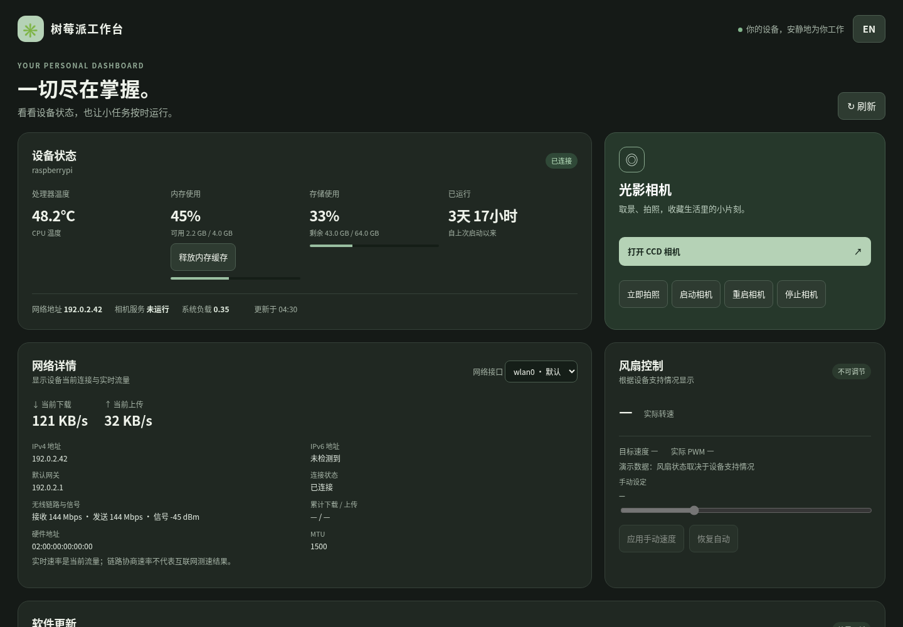
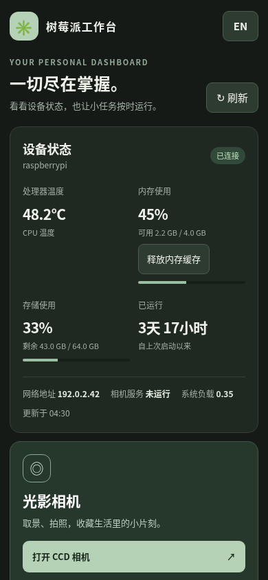

# Raspberry Pi Personal Workbench

[中文说明](README.md) · English

## Preview

These screenshots show the version 1.0 interface with simulated device data; the version 2.0 interface may differ.





## What's new in 2.0

- Browse workbench files, downloads and camera folders; create folders, rename, upload (up to 5 MB per file), download and move items to the system trash. Symbolic links are not shown. Trash requires `gio`.
- Storage analysis, camera and workbench service status and logs, and shutdown/restart controls, subject to system authorization. Power actions are blocked during updates or when recording status cannot be confirmed.
- Status history, alerts, connectivity checks and an on-demand download speed test that consumes network data.
- Editable web shortcuts and scheduled backups of a user directory to a separate, writable mounted filesystem. Backups are full snapshots; the workbench must be running and the destination mounted. Monitor available space and verify the results.

The 1.0 one-click updater can upgrade to 2.0: the backend includes fallback copies of the new modules when the older updater has not installed them yet. Future updates install the full set of files. Alternatively, use the manual upgrade below and keep a backup.

For an installation at `~/pi-workbench`, stop recordings and other active tasks, then run these commands on the Raspberry Pi:

```bash
cp -a ~/pi-workbench ~/pi-workbench-backup-$(date +%Y%m%d-%H%M%S)
stage=$(mktemp -d)
git clone --depth 1 https://github.com/Liu123215/raspberry-pi-workbench.git "$stage/source"
cp "$stage/source/"{workbench_extra.py,extras_v2.py,fan_control.py,update_service.py,index.html,backend.py} ~/pi-workbench/
systemctl --user restart pi-workbench.service
systemctl --user status pi-workbench.service --no-pager
```

For a manually started instance, stop the old process and run `python3 ~/pi-workbench/backend.py` instead of the `systemctl` commands. Keep the backup for rollback; remove the temporary download directory after checking that the new version works.

A Raspberry Pi dashboard for device and network details, compatible fan control, optional camera access, and scheduled tasks. Open it from a phone or computer on the same trusted network. The interface supports switching between Chinese and English.

## Features

- View CPU temperature, memory and storage usage, uptime, and the status of the separate camera service.
- Start, restart, or stop the CCD camera service; stop an active recording first.
- Take photos from the dashboard and view system load, reboot status, services, and resource-intensive processes.
- Refresh a diagnostics view of key service states and the processes using the most CPU.
- Manually release reclaimable system memory caches without closing programs or deleting user files.
- View interfaces, IPv4 and IPv6 addresses, gateways, MAC address, cumulative traffic, and current upload/download rates. Wi-Fi link rates and signal strength are shown when available. These values are not an internet bandwidth test.
- View and control a compatible `pwm-fan`. Manual mode continuously maintains a target PWM setting and preserves it across workbench service restarts. The target is temporarily overridden to request full speed if the CPU reaches 70°C or the temperature cannot be read; the system's thermal protections remain enabled. You can return to automatic control.
- Check and install system package updates and update the workbench from this repository.
- Schedule availability checks for one website; record state changes. This checks whether the site is reachable, not whether its content has changed.
- Schedule photos and browse recent images through the separately installed CCD Camera. Both scheduled tasks are disabled by default.

## Compatibility and scope

| Component | Requirements or limitations |
| --- | --- |
| Core dashboard | Intended for Raspberry Pi OS; requires Python 3 and `iproute2` for network details. The documentation does not yet contain device-by-device hardware validation. |
| Fan control | Requires a compatible `pwm-fan` kernel interface and a separately installed restricted helper; support depends on the device. |
| Camera and scheduled photos | Require the separately installed and configured [CCD Camera](https://github.com/Liu123215/raspberry-pi-ccd-camera). |
| System updates and background service | System updates require APT and non-interactive `sudo`; the background-service example uses systemd user services. |

## Privacy and access

Version 2.0 listens on the Raspberry Pi loopback interface on port 8092 by default. On first startup it generates a random access code in `~/.local/share/pi-workbench/access-token`, readable only by the service user. Enter the code on the login page; the browser stores a session cookie. On another computer, run `ssh -L 8092:127.0.0.1:8092 -L 8091:127.0.0.1:8091 user@pi-address`, keep the connection open, and visit `http://127.0.0.1:8092/` in that computer's browser. The second forwarded port enables the camera link; the independent camera service is not protected by the workbench access code.

**The workbench uses unencrypted HTTP. Use it only on a trusted local network, do not forward its port to the internet, and do not share the access code.** Anyone with the code can use the dashboard's controls, including updates and fan settings.

The [CCD Camera](https://github.com/Liu123215/raspberry-pi-ccd-camera) is a separate application. The workbench access code does not protect the camera service, which has no login by default. Do not expose it to an untrusted network.

## Requirements

- A Raspberry Pi running Raspberry Pi OS with Python 3 and systemd user services. A desktop is optional; a browser can connect over the local network.
- `iproute2` for network information; `iw` can provide supported Wi-Fi link data. Some interfaces do not report every value.
- A compatible `pwm-fan` interface and the separately installed restricted fan helper. Other devices have not all been tested; unsupported controls report the reason.
- A system using APT and non-interactive `sudo` for system package updates. Workbench updates require Git and access to GitHub.
- The separately installed CCD Camera for camera status, gallery, and scheduled capture. The remaining functions can run without it.

## Install and start

On the Raspberry Pi:

```bash
sudo apt update
sudo apt install -y git python3 iproute2 iw
git clone https://github.com/Liu123215/raspberry-pi-workbench.git ~/pi-workbench
cd ~/pi-workbench
python3 backend.py
```

To enable fan control, review `pi-workbench-fan` and the installer, then open another terminal and run `sudo sh install-fan-helper.sh` from the project directory. Installation requires your administrator password and grants the current user passwordless access only to the dedicated fan helper, not general passwordless sudo. Workbench self-updates do not replace the root-owned helper.

To enable memory-cache release, review `pi-workbench-memory` and its installer, then run `sudo sh install-memory-helper.sh` from the project directory. This fixed operation releases reclaimable kernel caches; it does not guarantee a large decrease in memory usage and may temporarily slow file access.

Press `Ctrl+C` to stop a foreground server. After the first startup, open another terminal and retrieve your access code and local network address:

```bash
cat ~/.local/share/pi-workbench/access-token
hostname -I
```

On the Raspberry Pi, open `http://127.0.0.1:8092/`. On another computer, first establish the SSH tunnel described above and open `http://127.0.0.1:8092/` in its browser. Keep the code private. Use the language control in the interface to switch between Chinese and English.

## Optional: run in the background

This example assumes the project is in `~/pi-workbench` and runs as the current user:

```bash
mkdir -p ~/.config/systemd/user
cat > ~/.config/systemd/user/pi-workbench.service <<'EOF'
[Unit]
Description=Personal Raspberry Pi Workbench
After=network.target

[Service]
Type=simple
WorkingDirectory=%h/pi-workbench
ExecStart=/usr/bin/python3 %h/pi-workbench/backend.py
Restart=on-failure
RestartSec=3

[Install]
WantedBy=default.target
EOF
systemctl --user daemon-reload
systemctl --user enable --now pi-workbench.service
```

Manage it with:

```bash
systemctl --user status pi-workbench.service
journalctl --user -u pi-workbench.service -f
systemctl --user restart pi-workbench.service
systemctl --user stop pi-workbench.service
```

When user services start depends on the system and login configuration. Enabling the service does not by itself guarantee startup when no user is logged in. Persistent manual fan control also depends on the workbench service running; kernel thermal management remains enabled.

## Updates and fan control

Use the **Software Update** area to check system or workbench updates, then confirm an installation. System installation uses `apt-get upgrade`, may take time, and may indicate that a reboot is required. System installation is blocked when enabled Debian sources from different releases are detected; inspect the sources before proceeding. Keep the device powered and connected throughout an update.

Workbench updates fetch the four application files from the same commit on this repository's `main` branch, back up the previous files, and restart the user service. Network failures, missing permissions, or an occupied package manager are reported as errors.

Fan percentages represent PWM duty cycle, not a guarantee of physical RPM. Manual mode continually reapplies the selected target while the service is running. The live PWM can briefly differ when the kernel adjusts the fan. At 70°C or if the temperature reading fails, the workbench attempts to request full speed; after the condition clears, it resumes the target. A 0 RPM reading can be normal when an automatically controlled fan is stopped at a low temperature.

## Troubleshooting

- **Page unavailable:** check that the service is active, use the correct local IP and port 8092, and verify that the devices can reach each other on the network.
- **Login fails:** inspect `~/.local/share/pi-workbench/access-token` on the Raspberry Pi. Do not share the code.
- **Fan unavailable or not adjustable:** check hardware support, kernel interfaces, and non-interactive `sudo` access.
- **Scheduled capture fails:** install and configure the CCD Camera separately and check its service on local port 8091. The scheduled task tries to start that service if needed; consult the task result and service logs.
- **Update fails:** check the displayed log, software source configuration, network and GitHub access, and systemd logs. Do not disconnect power during an update.

## Files

- `backend.py` — HTTP service, device status, and scheduled tasks.
- `index.html` — responsive dashboard interface.
- `fan_control.py` — compatible fan monitoring and control.
- `pi-workbench-fan` / `install-fan-helper.sh` — restricted fan helper and installer.
- `update_service.py` — system and workbench updates.
- `README.md` / `README.en.md` — Chinese and English documentation.

## Tests

Run `python3 -B -m unittest discover -s tests -v` from the repository directory. These tests do not require Raspberry Pi hardware; hardware-specific features still need testing on a device.

## License

This project is licensed under the [MIT License](LICENSE).
