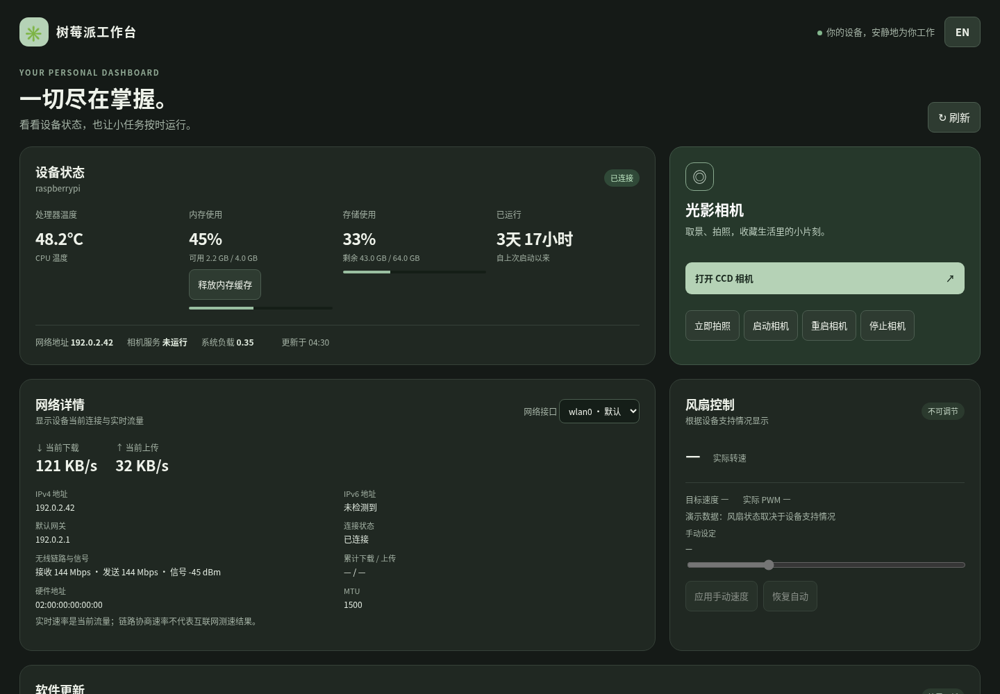
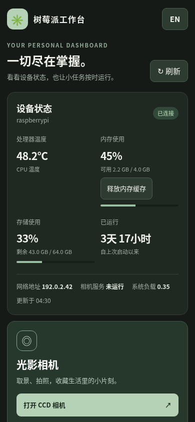

# 树莓派个人工作台

中文说明 · [English](README.en.md)

**在一个浏览器页面里管理你的树莓派：查看状态、整理文件、控制兼容风扇，并连接独立的光影相机。**

适合将树莓派作为桌面设备、轻量服务器或个人小项目中心使用。界面支持中文和英文；基础功能无需额外购买硬件，风扇、相机与外置备份功能需要对应设备或服务。

[功能](#功能) · [兼容性](#兼容性与使用范围) · [安装与启动](#安装与启动) · [日常使用](#日常使用) · [常见问题](#常见问题与排查) · [测试](#测试)

## 界面预览

以下截图展示 1.0 界面，设备数据为模拟数据；2.0 界面可能有所不同。





## 2.0 新功能

- 文件管理：浏览工作台文件、下载和相机目录；支持新建文件夹、重命名、上传（单文件最大 5 MB）、下载和移入系统回收站。符号链接不显示。回收站功能需要 `gio`。
- 存储分析、相机和工作台服务状态与日志，以及需要系统授权的关机、重启操作。工作台自身发起的更新进行中，或无法确认相机录像状态时，电源操作会被阻止。它不能保证识别所有从终端或其他程序启动的更新。
- 状态历史、异常提示、网络连通性与按需下载测速；测速会消耗网络流量。
- 常用网址快捷入口；可以配置独立挂载的可写磁盘作为照片或其他用户目录的定时备份目标。备份是完整快照，工作台运行且目标已挂载时才能执行；请留意空间占用并检查备份结果。

从 1.0 升级时，可以使用工作台的一键更新。为兼容旧版更新器，2.0 在新增模块尚未单独安装时会加载内置副本；后续更新会安装完整文件。也可以按以下方式手动升级，并保留备份。

如果按下文示例安装在 `~/pi-workbench`，可在树莓派终端运行以下命令。安装目录不同的话请先调整路径；更新之前请结束正在进行的录像和其他任务。

```bash
cp -a ~/pi-workbench ~/pi-workbench-backup-$(date +%Y%m%d-%H%M%S)
stage=$(mktemp -d)
git clone --depth 1 https://github.com/Liu123215/raspberry-pi-workbench.git "$stage/source"
cp "$stage/source/"{workbench_extra.py,extras_v2.py,fan_control.py,update_service.py,index.html,backend.py} ~/pi-workbench/
systemctl --user restart pi-workbench.service
systemctl --user status pi-workbench.service --no-pager
```

如果是手动在终端启动的工作台，请停止旧进程后重新运行 `python3 ~/pi-workbench/backend.py`，不必运行上面的 `systemctl` 命令。备份目录可用于回退；手动检查新版本运行正常后再自行清理临时下载目录。

一个运行在树莓派上的个人工作台：使用树莓派本机浏览器，或通过 SSH 隧道从其他设备访问，查看设备状态并操作常用功能。

## 功能

- 查看 CPU 温度、内存和存储使用情况、运行时间及相机服务状态。
- 启动、重启或停止光影相机服务；录像期间需先停止录像。
- 在工作台直接拍照，查看系统负载、是否需要重启、主要服务和资源占用较高的程序。
- 设备诊断区域列出主要服务状态和 CPU 使用率较高的进程，并可手动刷新。
- 可手动释放系统可回收的内存缓存；不会关闭程序或删除用户文件，清理后缓存会按需重新建立。
- 在界面中切换中文和英文，语言偏好保存在当前浏览器中。
- 查看网络接口、IPv4 / IPv6 地址、网关、MAC 地址、累计流量和当前上传、下载速率。链路协商速率不是互联网测速结果。
- 查看兼容风扇的转速并设置手动速度。工作台在手动模式下持续维持目标速度；为保护设备，温度异常或温度读数不可用时会强制全速。可随时切回自动温控。
- 检查并安装树莓派系统软件包更新；从本仓库检查和更新工作台程序。安装更新前请确认，并保持设备供电及网络连接。
- 按间隔检查一个网站是否能访问，并记录状态变化；这不是网页内容更新监控。
- 配合独立的光影相机服务定时拍照、查看最近照片。两项自动任务默认关闭，须由用户启用。

## 兼容性与使用范围

| 组件 | 要求或限制 |
| --- | --- |
| 基础工作台 | 面向 Raspberry Pi OS；需要 Python 3，查看网络详情需要 `iproute2`。当前文档没有逐型号的实机验证记录。 |
| 风扇控制 | 需要兼容的 `pwm-fan` 内核接口和单独安装的受限助手；支持情况取决于设备。 |
| 相机与定时拍照 | 需要单独安装并配置[光影相机](https://github.com/Liu123215/raspberry-pi-ccd-camera)。 |
| 系统更新和后台服务 | 系统更新需要 APT 和非交互式 `sudo`；后台运行示例使用 systemd 用户服务。 |

## 隐私与访问

2.0 默认仅监听树莓派本机的 8092 端口。首次启动会生成随机访问码，保存在 `~/.local/share/pi-workbench/access-token`，文件仅供当前用户读取。打开页面后输入访问码，工作台使用浏览器 Cookie 保存登录状态。

**工作台在本机使用 HTTP，远程访问请使用 SSH 隧道加密连接。不要将端口直接暴露到公网，也不要分享访问码。** 网站检查会访问你设置的地址；只有信任的用户才应获得访问码。

本工作台可以链接独立的 [光影相机](https://github.com/Liu123215/raspberry-pi-ccd-camera)。工作台的访问码不会保护该相机服务；该相机默认也不提供登录验证，不要将其端口暴露到不可信网络。

## 环境要求

- 运行 Raspberry Pi OS 的树莓派，需有 Python 3 和 systemd 用户服务；通过浏览器访问，无需树莓派桌面环境。
- 网络详情依赖系统的 `ip` 命令；部分无线网卡可能无法报告链路协商速率。
- 风扇功能依赖设备及内核暴露兼容的 `pwm-fan` 接口，并需要单独安装受限的风扇助手。不支持时页面会显示原因。不同设备尚未逐一测试。
- 系统软件包更新适用于使用 `apt` 的系统，且需要非交互式 `sudo`。工作台更新需能访问 GitHub。
- 相机和定时拍照功能需要单独安装和配置光影相机，其余功能可独立使用。

## 安装与启动

在树莓派的终端中执行。以下示例会安装到 `~/pi-workbench`；如果该目录已经存在，请先检查现有内容，不要直接覆盖：

```bash
sudo apt update
sudo apt install -y git python3 iproute2
git clone https://github.com/Liu123215/raspberry-pi-workbench.git ~/pi-workbench
cd ~/pi-workbench
python3 backend.py
```

如需启用风扇控制，请先查看 `pi-workbench-fan` 和安装脚本的内容，再打开另一个终端，在项目目录中运行 `sudo sh install-fan-helper.sh`。安装会请求管理员密码，并仅授予当前用户调用专用风扇助手的免密码权限，不会授予通用免密码 sudo。工作台自更新不会自动更换 root 持有的风扇助手。

如需启用内存缓存清理，请先检查 `pi-workbench-memory` 及安装脚本，然后在项目目录运行 `sudo sh install-memory-helper.sh`。该助手仅提供释放可回收内核缓存的固定操作；清理不保证能显著降低内存占用，且可能暂时降低文件读取速度。

终端中按 `Ctrl+C` 可以停止服务。首次启动后，另开终端读取访问码：

```bash
cat ~/.local/share/pi-workbench/access-token
hostname -I
```

在树莓派浏览器打开 `http://127.0.0.1:8092/`。从另一台电脑访问时，先在该电脑的终端运行 `ssh -L 8092:127.0.0.1:8092 -L 8091:127.0.0.1:8091 用户名@树莓派IP` 并保持连接，再在该电脑浏览器打开 `http://127.0.0.1:8092/`。第二个端口转发供工作台的相机入口使用；相机服务独立运行，不受工作台访问码保护。访问码应妥善保管。

## 可选：后台用户服务

如果前面正在前台运行 `python3 backend.py`，请先在该终端按 `Ctrl+C`，避免两个进程争用 8092 端口。以下示例假设项目位于 `~/pi-workbench`，以当前用户身份运行：

```bash
mkdir -p ~/.config/systemd/user
cat > ~/.config/systemd/user/pi-workbench.service <<'EOF'
[Unit]
Description=Personal Raspberry Pi Workbench
After=network.target

[Service]
Type=simple
WorkingDirectory=%h/pi-workbench
ExecStart=/usr/bin/python3 %h/pi-workbench/backend.py
Restart=on-failure
RestartSec=3

[Install]
WantedBy=default.target
EOF
systemctl --user daemon-reload
systemctl --user enable --now pi-workbench.service
```

```bash
systemctl --user status pi-workbench.service
journalctl --user -u pi-workbench.service -f
systemctl --user restart pi-workbench.service
systemctl --user stop pi-workbench.service
```

用户服务启动时机取决于系统和登录设置；仅执行 `enable` 并不保证无人登录时服务会随设备启动。

## 日常使用

### 文件、存储和回收站

在“设备管理”中选择目录，进入文件夹后可新建目录、上传、下载、重命名或将项目移入系统回收站。为了限制访问范围，文件管理只显示以下三个根目录：

| 界面位置 | 树莓派上的目录 | 说明 |
| --- | --- | --- |
| 工作台文件 | `~/Workbench Files` | 首次正常启动工作台时创建 |
| 下载文件 | `~/Downloads` | 目录不存在时需要先创建 |
| 相机相册 | `~/Pictures/CCD Camera` | 需要相机产生或用户自行创建该目录 |

单个上传文件上限为 **5 MiB**；目录列表最多显示 1000 项，符号链接不会显示。删除操作通过 `gio trash` 移入回收站，不是永久清除；回收站是否可用取决于系统及目标文件所在文件系统。存储分析统计上述目录，不代表整张磁盘的文件分类。

### 网络、历史和提醒

实时上传/下载速度、接口信息与 Wi-Fi 链路速率用于观察当前设备；链路速率不等于互联网实际下载速度。网络工具中的连通性检查是到 `1.1.1.1:53` 的 TCP 连接，延迟只针对该目标；按需下载测速会访问 Cloudflare 并下载约 2 MB 样本，结果受线路、服务器和测试时长影响，不能视为精确带宽测试。

工作台运行时约每分钟采样一次，最多保留 1440 条记录。当前异常提示包括 CPU 温度达到 80°C、剩余空间低于 10%、相机服务处于失败状态和没有检测到 IP 地址；“无网络”提示根据本机 IP 判断，不能证明互联网是否可访问。这些提醒显示在工作台中，不会自动推送到手机。

### 自动备份

1. 准备另一块已挂载、可写入的磁盘或其他独立文件系统。在树莓派终端用 `lsblk -f` 和 `findmnt` 查看实际挂载位置。
2. 在工作台的备份区域填写**已存在的用户主目录内子目录**作为来源，例如 `/home/你的用户名/Pictures/CCD Camera`；填写另一个文件系统上已存在的可写目录作为目标。
3. 设置间隔（1～720 小时），保存并启用；也可以先运行一次手动备份，检查目标中的文件和上次成功时间。

来源不能是整个主目录，来源与目标不能互相包含，目标也不能与来源处于同一文件系统。每次是**完整快照**，不是增量备份；请自行确认容量和恢复方法。工作台必须运行且目标已挂载；失败时可能留下 `.partial` 目录，请检查原因后自行处理。同一张 SD 卡上的另一份文件不构成独立备份。

### 相机和自动任务

相机是[独立项目](https://github.com/Liu123215/raspberry-pi-ccd-camera)，需要安装并启动自己的服务；工作台本身不包含相机驱动。网站检查只报告访问状态变化，不比较网页正文。定时拍照与网站检查默认关闭；请在对应区域启用并保存设置。

关机和重启会检查工作台自身发起的更新及相机录像状态，但不能保证识别其他终端或程序启动的系统更新。执行前请自行确认没有其他任务正在写入；电源操作还取决于系统授权。

## 更新和风扇

在工作台的“软件更新”区域，可分别检查系统和工作台更新，确认后再安装。系统更新使用 `apt-get upgrade`，可能需要较长时间或提示重启；如果检测到启用的 Debian 软件源混用不同发行版，系统安装会被阻止，应先检查软件源。工作台更新从本仓库 `main` 分支的同一个提交下载程序文件、备份旧文件并重启工作台。GitHub 不可访问、权限不足或软件包管理器被占用时，操作会显示错误，不会伪装成成功。

风扇的百分比是 PWM 控制值，不是实际转速百分比。手动模式会持续维持目标占空比；当 CPU 温度达到安全阈值或温度读数不可用时，保护机制会临时要求全速，降温后恢复目标。系统热保护不会关闭。转速为 0 RPM 在低温自动停转时可能是正常现象。更换设备后应确认硬件和散热正常，再使用调节功能。

## 常见问题与排查

### 页面无法打开

1. 在树莓派运行 `systemctl --user status pi-workbench.service --no-pager`。如果你是直接用终端启动的，请检查 `python3 backend.py` 的终端是否仍在运行。
2. 查看本机端口：`ss -lnt | grep 8092`。2.0 默认监听 `127.0.0.1:8092`，**不能在其他设备直接输入树莓派 IP:8092**。
3. 远程电脑需要建立上文的 SSH 隧道，并在同一台电脑的浏览器打开 `http://127.0.0.1:8092/`。保持 SSH 窗口打开；登录失败先检查用户名、IP、SSH 服务与网络。
4. 提示端口被占用时，先确认冲突发生在树莓派还是建立隧道的电脑；在 Linux 设备上可用 `ss -lntp | grep 8092` 查看占用进程，确认身份后再处理，不要盲目停止不认识的服务。日志可用 `journalctl --user -u pi-workbench.service -n 100 --no-pager` 查看。

### 忘记访问码或一直要求登录

在树莓派上运行 `cat ~/.local/share/pi-workbench/access-token`，复制完整内容，注意不要包含空格。确认浏览器允许 Cookie，并使用建立隧道的同一台设备和地址。访问码有管理权限，请勿贴到公开 issue 或截图中。

### 服务无法启动或开机后没有运行

先执行 `systemctl --user status pi-workbench.service --no-pager` 和 `journalctl --user -u pi-workbench.service -n 100 --no-pager`。确认 `WorkingDirectory` 与 `ExecStart` 的目录和实际安装位置一致，Python 3 与相关文件存在。启用用户服务不一定意味着无人登录时自动启动；如确实需要该行为，请结合你的系统检查 systemd 用户会话和 linger 设置。

### 风扇看不到、速度不能调或总是全速

- 检查硬件连接和供电，确认系统存在兼容 `pwm-fan` 接口；并非所有树莓派型号或第三方风扇均支持软件调速。`find /sys/class/hwmon -maxdepth 2 -name name -print` 可协助定位设备。
- 查阅页面错误，确认已按安装章节为**运行工作台的用户**安装受限风扇助手。权限问题请检查对应 sudo 规则和安装脚本输出；不要授予通用免密码 sudo。
- 手动档位范围为 30%～100%，表示 PWM 控制值，并不等于实际 RPM 的百分比。达到 70°C 或无法读取温度时，保护逻辑会请求全速；降温或读数恢复后再检查。自动模式下低温停转也可能正常。

### 系统更新失败或提示软件源混用

展开页面更新日志，确认网络连接、APT 软件源与磁盘空间。终端可先只读查看 `cat /etc/os-release` 和 `apt-cache policy`；如果工作台警告 Debian 软件源混用发行版，应先核对当前系统版本和软件源，避免直接强行升级。APT 锁被占用时先确认其他更新进程是否仍在运行，不要删除锁文件。系统更新需要用户具备相应的非交互式 sudo 授权；过期或未配置时请根据日志在终端处理。

### 工作台更新失败或升级后无响应

检查树莓派能否访问 GitHub、是否安装 Git，随后查看 `journalctl --user -u pi-workbench.service -n 100 --no-pager`。旧版升级和手动恢复方法见上方 2.0 升级说明；备份目录里的文件可用于回退。工作台一键更新需要可用的 systemd 用户服务，并会安排该服务重启；等待片刻再刷新浏览器。仅以前台方式运行时，请使用上方的手动升级方法。

### 相机打不开或定时拍照失败

确认已单独安装并启动光影相机；查看 `systemctl --user status ccd-camera.service --no-pager` 和 `journalctl --user -u ccd-camera.service -n 100 --no-pager`。在树莓派上检查 8091 端口；远程浏览器打开相机入口时，还要转发上文列出的 8091 端口。相机服务没有工作台的访问码保护，请限制它的网络访问。

### 文件列表为空、上传失败或无法删除

确认选中正确目录并在树莓派检查该目录存在及当前用户的读写权限；上传单个文件不能超过 5 MiB，同名目标不会被覆盖，符号链接不显示。删除需要 `gio` 和相应回收站支持；在使用 APT 的 Raspberry Pi OS 上可检查 `command -v gio`，缺少时可安装 `glib2.0-bin`。失败时请检查依赖与所在文件系统。请先确认内容，再使用系统文件管理器处理。

### 备份无法启用、运行失败或一直未更新

检查来源和目标均已存在，来源是主目录里的子目录，目标位于已挂载、可写的另一文件系统，且两者不互相包含。通过 `findmnt`、`lsblk -f` 与 `df -h` 检查挂载和剩余空间；查看界面上次成功时间与错误信息。工作台关闭或磁盘未挂载时无法执行，复制大目录需要时间和足够空间；失败的 `.partial` 文件夹不是完成的备份。

### 网速为零、数据与路由器不同或测速失败

实时速度表示采样期间树莓派接口的流量；空闲时接近零属于正常情况。Wi-Fi 链路速率、实时流量和公网下载测速含义不同。若测速失败，检查网络是否允许连接测速服务；如果 TCP 连通性检查失败，可能是目标或网络策略阻止了连接，并不一定意味着所有网站都不可用。

### 关机或重启被阻止

先停止相机录像并等待工作台自身更新结束，再确认系统没有其他更新。若相机服务状态异常、接口无法确认录像状态，先检查相机服务日志。实际执行关机/重启还需要系统授予当前用户相应权限。

### 报告问题前需要准备什么？

记录设备型号、Raspberry Pi OS 版本、操作步骤、错误信息和相关日志；可通过 `cat /etc/os-release`、`uname -a` 和上面的 `journalctl` 命令收集信息。发布之前请删除访问码、用户名、个人文件路径、私网地址和其他敏感内容，再到 [Issues](https://github.com/Liu123215/raspberry-pi-workbench/issues) 提交。尽量说明实际结果和预期结果，方便复现。

## 数据位置与停用

配置、访问码、状态历史和更新状态保存在 `~/.local/share/pi-workbench/`；照片由独立相机保存，工作台文件默认位于 `~/Workbench Files`。卸载代码前请先确认需要保留哪些内容，访问码文件不要公开分享。

如使用上面的 systemd 用户服务，可以运行 `systemctl --user disable --now pi-workbench.service` 停止并取消启用；前台运行的进程可按 `Ctrl+C` 停止。这些操作不会自动删除照片、配置或安装的受限助手。

## 文件

- `backend.py`：网页服务、设备状态和自动任务。
- `index.html`：手机和电脑浏览器界面。
- `fan_control.py`：兼容风扇的状态读取与控制。
- `pi-workbench-fan` / `install-fan-helper.sh`：权限受限的风扇助手及安装脚本。
- `update_service.py`：系统和工作台更新。
- `workbench_extra.py`：文件管理、存储、服务和电源操作。
- `extras_v2.py`：状态历史、备份、网络工具和快捷入口。
- `pi-workbench-memory` / `install-memory-helper.sh`：权限受限的缓存清理助手及安装脚本。

## 测试

在仓库目录运行 `python3 -B -m unittest discover -s tests -v`。这些测试无需树莓派硬件；硬件相关功能仍需要实机验证。

## 反馈与贡献

欢迎通过 [Issues](https://github.com/Liu123215/raspberry-pi-workbench/issues) 报告可复现的问题或提出建议，也欢迎通过 Pull Request 改进文档和代码。提交硬件兼容性反馈时请注明型号、系统版本和实测结果。觉得项目有帮助的话，欢迎在仓库点一个 Star，帮助更多树莓派用户发现它。

## 许可证

本项目采用 [MIT License](LICENSE)。
